<!-- datasheet:banner -->

  <picture>
    <source media="(prefers-color-scheme: dark)" srcset=".github/assets/banner-dark.svg">
    
  </picture>

<!-- /datasheet:banner -->

# Hi, I'm SK

I build local-first tools: things that run on your own machine, keep your data on your own disk, and don't phone home unless you tell them to. Most of what's below started as "I wanted this and it didn't exist": a converter, an exporter, a visualizer, a library fixer, and a few boards.

## Index

  <picture>
    <source media="(prefers-color-scheme: dark)" srcset=".github/assets/diagram-dark.svg">
    
  </picture>

## Projects

Each repository is a numbered sheet (`U1`, `U2`, ...) of the same datasheet as my [personal site](https://github.com/S-k404/portfolio).

### Local AI and audio

| Sheet | Project | What it does |
| --- | --- | --- |
| `U1` | [**kokoro-audiobook-studio**](https://github.com/S-k404/kokoro-audiobook-studio) | Turns textbooks and technical PDFs into chaptered M4B audiobooks, fully local on Apple Silicon (Kokoro TTS, Metal GPU). |
| `U7` | [**odysseus-speech-tools**](https://github.com/S-k404/odysseus-speech-tools) | Local speech engine (Kokoro-82M TTS + Faster-Whisper STT), document narrators and audio pipelines for the Odysseus workspace. |
| `U8` | [**odysseus-image-tools**](https://github.com/S-k404/odysseus-image-tools) | MCP server and CLI for local image inpainting and region detection, for Odysseus. |
| `U6` | [**odysseus-notion-skill**](https://github.com/S-k404/odysseus-notion-skill) | A read-only Notion tool/skill for the Odysseus local-model agent: search and read Notion live, nothing cached to disk. |

### Files and data

| Sheet | Project | What it does |
| --- | --- | --- |
| `U2` | [**notion-better-export**](https://github.com/S-k404/notion-better-export) | High-fidelity Notion workspace exporter. Preserves folder hierarchy, Obsidian Bases and linked CSV databases instead of Notion's flat default export. |
| `U4` | [**better-vert**](https://github.com/S-k404/better-vert) | Local-first universal file converter: 250+ formats via FFmpeg/ImageMagick, plus anything-to-Markdown via MarkItDown, OCR and Poppler. Web UI + CLI in one Docker container. |
| `U3` | [**music-tools**](https://github.com/S-k404/music-tools) | A CLI (`mt`) for curating a local music library: album art repair, artist art and lyrics, duplicate detection, misidentified tag fixes, library stats. |
| `U9` | [**grab**](https://github.com/S-k404/grab) | Fast parallel batch downloader for video streams, images and files (`yt-dlp` + `ffmpeg`) with Web GUI, CLI and browser extension. |

### Hardware

| Sheet | Project | What it does |
| --- | --- | --- |
| `U16` | [**heater-driver-v4**](https://github.com/S-k404/heater-driver-v4) | 12 V / 100 W through-hole PCB heater driver with over-current and over-temperature protection and an assembly placement guide. |
| `U17` | [**solder-reflow-pad**](https://github.com/S-k404/solder-reflow-pad) | KiCad solder reflow hotplate pad with a custom artistic silkscreen layer. |
| `U18` | [**pi5-homelab-rack**](https://github.com/S-k404/pi5-homelab-rack) | Modular 3D-printed 9U rack ecosystem and design scripts for a Raspberry Pi 5. |
| `U15` | [**esp32-sensor-probe**](https://github.com/S-k404/esp32-sensor-probe) | ESP32 and Arduino environmental sensor probes with ST7789 IPS and OLED support, in C++ and MicroPython. |

### Apps and terminal

| Sheet | Project | What it does |
| --- | --- | --- |
| `U10` | [**aether-7**](https://github.com/S-k404/aether-7) | Cyberpunk telemetry HUD and kiosk monitor for Raspberry Pi 5 + 7-inch displays, with Hailo-8 NPU and Apple Silicon metrics. |
| `U11` | [**flight-live**](https://github.com/S-k404/flight-live) | Native iOS & macOS flight tracking with Dynamic Island, Live Activities and Notion flight import. |
| `U12` | [**study-copilot**](https://github.com/S-k404/study-copilot) | Native macOS menu bar study copilot with screen-region OCR, an explainer engine and a local offline practice sandbox. |
| `U5` | [**music-visualiser**](https://github.com/S-k404/music-visualiser) | Two visualisers, one repo: a macOS terminal app with real-time ASCII/pixel rendering, and ESP32 + OLED firmware showing a live spectrum over Bluetooth. |
| `U13` | [**fetch3d**](https://github.com/S-k404/fetch3d) | 3D rotating Apple-logo system fetch for macOS, in zero-dependency pure C using Mach and sysctl APIs. |
| `U14` | [**ascii-dino**](https://github.com/S-k404/ascii-dino) | Chrome Dino endless runner in the terminal, written in Python `curses` and containerized with Docker. |

## Notes

- Everything above is local-first by design: no required cloud dependency, no telemetry, data stays on disk unless the tool's whole point is to export it somewhere you chose.
- Each repo's README has full setup and usage instructions. The tables above are just a map.
