<!-- datasheet:banner -->

  <picture>
    <source media="(prefers-color-scheme: dark)" srcset=".github/assets/banner-dark.svg">
    
  </picture>

<!-- /datasheet:banner -->

# Hi, I'm SK

I build local-first tools: things that run on your own machine, keep your data on your own disk, and don't phone home unless you tell them to. Most of what's below started as "I wanted this and it didn't exist": a converter, an exporter, a visualizer, a library fixer, and a few boards.

## Index

  <picture>
    <source media="(prefers-color-scheme: dark)" srcset=".github/assets/diagram-dark.svg">
    
  </picture>

## Projects

Each repository is a numbered sheet (`U1`, `U2`, ...) of the same datasheet as my [personal site](https://portfolio-5nj.pages.dev/). Each sheet's page links to the previous and next one.

### Local AI and audio

| Sheet | Project | What it does |
| --- | --- | --- |
| `U1` | [**kokoro-audiobook-studio**](https://github.com/S-k404/kokoro-audiobook-studio) | Turns textbooks and technical PDFs into chaptered M4B audiobooks, fully local on Apple Silicon (Kokoro TTS, Metal GPU) and Windows 11 (CUDA/CPU). |
| `U6` | [**odysseus-notion-skill**](https://github.com/S-k404/odysseus-notion-skill) | A read-only Notion tool and skill for the Odysseus local-model agent: search and read Notion live, nothing cached to disk. |
| `U7` | [**odysseus-speech-tools**](https://github.com/S-k404/odysseus-speech-tools) | A local OpenAI-compatible speech engine for Odysseus (Kokoro TTS + Faster-Whisper STT), document narrators and a PDF-to-audiobook converter. |

### Files and data

| Sheet | Project | What it does |
| --- | --- | --- |
| `U2` | [**notion-better-export**](https://github.com/S-k404/notion-better-export) | Exports a whole Notion workspace into Obsidian: real folders, linked CSVs and Bases that mirror your Notion views. |
| `U3` | [**music-tools**](https://github.com/S-k404/music-tools) | A CLI (`mt`) for cleaning up a local music library: cover and artist art, lyrics, wrong tags, duplicates, unknown songs (Shazam) and messy folders. Every tool previews first. |
| `U4` | [**better-vert**](https://github.com/S-k404/better-vert) | Local-first universal converter: 250+ formats through FFmpeg and ImageMagick, anything to Markdown, PDF merge and split. Web UI and CLI in one Docker container. |
| `U9` | [**grab**](https://github.com/S-k404/grab) | Fast parallel batch downloader for videos, images and files (`yt-dlp`, `gallery-dl`, `aria2c`) with a CLI, web GUI, Mac app and browser extension, plus a headless-browser fallback for pages they don't know. |
| `U21` | [**openfoam-mac-suite**](https://github.com/S-k404/openfoam-mac-suite) | Turnkey OpenFOAM v2512 CFD environment for macOS and Windows 11 (WSL2), with native ParaView, live convergence dashboard and aerodynamics toolkit. |

### Hardware

| Sheet | Project | What it does |
| --- | --- | --- |
| `U15` | [**esp32-sensor-probe**](https://github.com/S-k404/esp32-sensor-probe) | ESP32 + BME280 probe with a colour IPS screen and four display modes, plus an Arduino Uno DHT22 + OLED weather station. |
| `U16` | [**heater-driver-v4**](https://github.com/S-k404/heater-driver-v4) | 12 V / 100 W through-hole PCB heater driver with latching over-current and over-temperature protection, a placement guide and a simulation. |
| `U17` | [**solder-reflow-pad**](https://github.com/S-k404/solder-reflow-pad) | KiCad hotplate PCB: a copper-spiral heater with an ATtiny1614 controller, an OLED, buttons and a buzzer. |
| `U18` | [**pi5-homelab-rack**](https://github.com/S-k404/pi5-homelab-rack) | A printed 10-inch, 9U mini rack for a Raspberry Pi 5, a 7-inch screen and a gateway, with every CAD and print file. |
| `U23` | [**card-wallet**](https://github.com/S-k404/card-wallet) | Minimalist mechanical card wallet plate designed as an 85.6 × 54.0 mm FR-4 printed circuit board in KiCad. |

### Apps and terminal

| Sheet | Project | What it does |
| --- | --- | --- |
| `U5` | [**music-visualiser**](https://github.com/S-k404/music-visualiser) | Two visualisers: a cross-platform terminal app (macOS, Linux, Windows 11) with real-time ASCII/pixel album art, waveform and spectrum, and ESP32 + OLED firmware that shows a live spectrum over Bluetooth. |
| `U11` | [**flight-live**](https://github.com/S-k404/flight-live) | iPhone flight tracker with a Flighty-style Live Activity and Dynamic Island, a Home Screen widget, Siri and Shortcuts, boarding passes, and Notion, calendar and Flighty import. |
| `U12` | [**study-copilot**](https://github.com/S-k404/study-copilot) | Cross-platform desktop and macOS menu bar study copilot: select part of your screen or copy text and get a step-by-step explanation from Claude, Gemini or an offline mock engine, plus a local practice quiz. |
| `U19` | [**mc-server-manager**](https://github.com/S-k404/mc-server-manager) | Local Minecraft server manager (`mc` CLI and Textual TUI) for macOS, Linux and Windows 11 with automatic world backups, Docker/native runtimes and VPN port-forwarding diagnostics. |
| `U13` | [**fetch3d**](https://github.com/S-k404/fetch3d) | 3D rotating Apple-logo system fetch for macOS, Linux and Windows 11, in zero-dependency pure C using native OS telemetry. |
| `U14` | [**ascii-dino**](https://github.com/S-k404/ascii-dino) | Chrome Dino endless runner in the terminal (Python `curses` on POSIX, VT100/`msvcrt` on Windows 11, Docker), with three difficulties and auto-play. |

### Forks I contribute to

| Project | What it is |
| --- | --- |
| [**learnharness**](https://github.com/S-k404/learnharness) | A fork of [amosblomqvist/learnharness](https://github.com/amosblomqvist/learnharness), an agent harness for learning difficult things. My fork adds Docker support, reading PowerPoint decks, a text-first fallback for PDFs, and chat compaction and connection retries for local models. |
| [**odysseus**](https://github.com/S-k404/odysseus) | A fork of [odysseus-dev/odysseus](https://github.com/odysseus-dev/odysseus), the self-hosted AI workspace that the Odysseus tools above plug into. |

## Notes

- Everything above is local-first by design: no required cloud dependency, no telemetry, data stays on disk unless the tool's whole point is to export it somewhere you chose.
- Each repo's README has full setup and usage instructions. The tables above are just a map.
